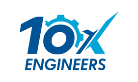
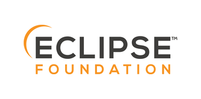

<div align="center">

<picture>
  <source media="(prefers-color-scheme: dark)" srcset=".github/brand/atesor-logo-dark.svg">
  
</picture>

# Eclipse Atesor™

**From source to verified riscv64.**

[](https://eclipse.dev/atesor/docs/)
[](LICENSE)
[](https://www.python.org/downloads/)
[](https://github.com/langchain-ai/langgraph)
[](https://github.com/eclipse-atesor/atesor/actions/workflows/regression-tests.yml)
[](https://github.com/eclipse-atesor/atesor/actions/workflows/batch-port.yml)
[](https://github.com/eclipse-atesor/atesor/actions/workflows/llm-health.yml)
[](https://github.com/eclipse-atesor/atesor/actions/workflows/package-deb.yml)

**[Documentation](https://eclipse.dev/atesor/docs/)** · [Website](https://eclipse.dev/atesor/) · [Packages](https://eclipse.dev/atesor/downloads/) · [Mailing list](https://accounts.eclipse.org/mailing-list/atesor-dev)

<sub>Recognized by</sub>

<a href="https://10xengineers.ai"></a>&nbsp;&nbsp;
<a href="https://www.eclipse.org"></a>&nbsp;&nbsp;
<a href="https://openhwfoundation.org"></a>

</div>

---

Eclipse Atesor™ is an open-source agentic framework that ports software to RISC-V. It builds each package natively on riscv64, repairs what breaks, proves that every binary is riscv64 code, and writes a replayable recipe. Its goal is to help the RISC-V ecosystem catch up, one verified package at a time.

## What Atesor supports

| Area | Today |
|---|---|
| Languages | C, C++ and Go. Rust and Node.js have partial support. |
| Build systems | Make, CMake, autotools and Go modules get a default plan with no LLM call. The LLM scout plans Meson, Cargo, npm and others. More build systems will follow. See [Build systems](https://eclipse.dev/atesor/docs/reference/build-systems/). |
| Sandboxes | Alpine Linux riscv64 (musl) and Debian/Ubuntu riscv64 (glibc). See [Sandboxes](https://eclipse.dev/atesor/docs/guides/sandboxes/). |
| Targets | `qemu` (default): QEMU emulation on an x86-64 or ARM Linux host. `native`: a real riscv64 machine over SSH. |
| LLM providers | Gemini (default), OpenAI, OpenRouter and Anthropic |
| Output | Verified riscv64 binaries, a Markdown recipe, the patches, a build report, and with `--package` a zip with a manifest. See [Read the output](https://eclipse.dev/atesor/docs/getting-started/read-the-output/). |

## Quick start

You need a Linux host with Docker, Python 3.10 or newer, and one LLM API key. [Requirements](https://eclipse.dev/atesor/docs/getting-started/requirements/) gives the full list.

```bash
# 1. Register riscv64 emulation (one time, on an x86-64 or ARM host)
docker run --privileged --rm tonistiigi/binfmt --install all

# 2. Install from source
git clone https://github.com/eclipse-atesor/atesor
cd atesor
pip install -r requirements.txt
cp .env-example .env        # then add your API key

# 3. Build the Alpine sandbox image (one time)
python3 main.py --setup-only

# 4. Port a package
python3 main.py --repo https://github.com/madler/zlib --force --verbose
```

The full setup is in the docs: [Install Atesor](https://eclipse.dev/atesor/docs/getting-started/install/), [Configure the LLM provider](https://eclipse.dev/atesor/docs/getting-started/configure-llm/) and [Your first port](https://eclipse.dev/atesor/docs/getting-started/first-port/).


## Architecture

Atesor is a [LangGraph](https://github.com/langchain-ai/langgraph) state graph in `src/graph.py`, with 13 nodes, 9 routing functions and a build-verify-fix subgraph. One `AgentState` object carries all data of a run from node to node. Five nodes can call an LLM. The other nodes use scripts and rules only.

<p align="center">
  <a href="https://eclipse.dev/atesor/docs/architecture/overview/">
    <picture>
      <source media="(prefers-color-scheme: dark)" srcset="https://eclipse.dev/atesor/docs/diagrams/architecture-dark.svg">
      
    </picture>
  </a>
</p>

[Architecture overview](https://eclipse.dev/atesor/docs/architecture/overview/) gives each routing condition of the graph.

The code has three layers:

- **Scripted operations** (`src/scripted_ops.py`, `src/evidence.py`) clone the repository, detect the build system, extract the dependencies and scan for architecture-specific code, at no LLM cost. See [Scripted operations](https://eclipse.dev/atesor/docs/architecture/scripted-ops/).
- **The state graph** (`src/graph.py`) gives each node its own routing function and the same error handling through `@agent_node`. See [Architecture overview](https://eclipse.dev/atesor/docs/architecture/overview/) and [Agent state](https://eclipse.dev/atesor/docs/architecture/agent-state/).
- **Platform profiles** (`src/platforms.py`) hold one `PlatformProfile` for each distribution, so the rest of the code stays distro-agnostic. See [Add a platform](https://eclipse.dev/atesor/docs/contributing/add-a-platform/).

[LLM layer](https://eclipse.dev/atesor/docs/architecture/llm-layer/) and [Performance mode internals](https://eclipse.dev/atesor/docs/architecture/optimize/) give the other parts.

## Documentation

The full documentation is at **[eclipse.dev/atesor/docs](https://eclipse.dev/atesor/docs/)**. Good places to start:

- [What is Atesor](https://eclipse.dev/atesor/docs/introduction/what-is-atesor/) and [How it works](https://eclipse.dev/atesor/docs/introduction/how-it-works/)
- [Install Atesor](https://eclipse.dev/atesor/docs/getting-started/install/) and [Your first port](https://eclipse.dev/atesor/docs/getting-started/first-port/)
- [Command-line options](https://eclipse.dev/atesor/docs/reference/cli/) and [Troubleshooting](https://eclipse.dev/atesor/docs/guides/troubleshooting/)

## Contributing

Contributions are welcome. Good places to start are new platform profiles, few-shot examples from real porting runs, recovery heuristics, and bug reports for packages that fail.

Read [CONTRIBUTING.md](CONTRIBUTING.md) and [Development setup](https://eclipse.dev/atesor/docs/contributing/development-setup/).

## Developers

[Akif Ejaz](https://github.com/akifejaz) of [10xEngineers](https://10xengineers.ai) leads the project and develops it. The Eclipse [Who is involved](https://projects.eclipse.org/projects/openhw.atesor/who) page lists the current project leads and committers. GitHub lists all [contributors](https://github.com/eclipse-atesor/atesor/graphs/contributors).

## Licence

Eclipse Atesor uses the [MIT licence](LICENSE).

Eclipse Atesor is an Eclipse Foundation project in incubation, under OpenHW. See the [Eclipse project page](https://projects.eclipse.org/projects/openhw.atesor) and [Governance](https://eclipse.dev/atesor/docs/project/governance/).

Eclipse Atesor, Atesor, Eclipse, and the Eclipse logo are trademarks of Eclipse Foundation AISBL. RISC-V is a registered trademark of RISC-V International. Other names and logos are trademarks of their owners.
